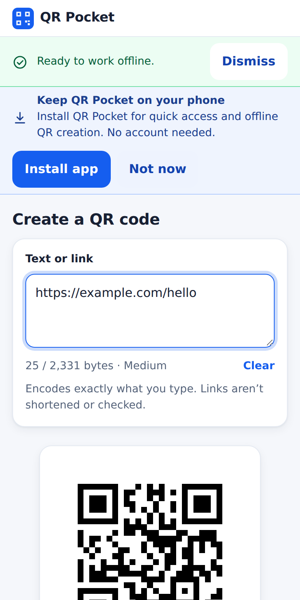
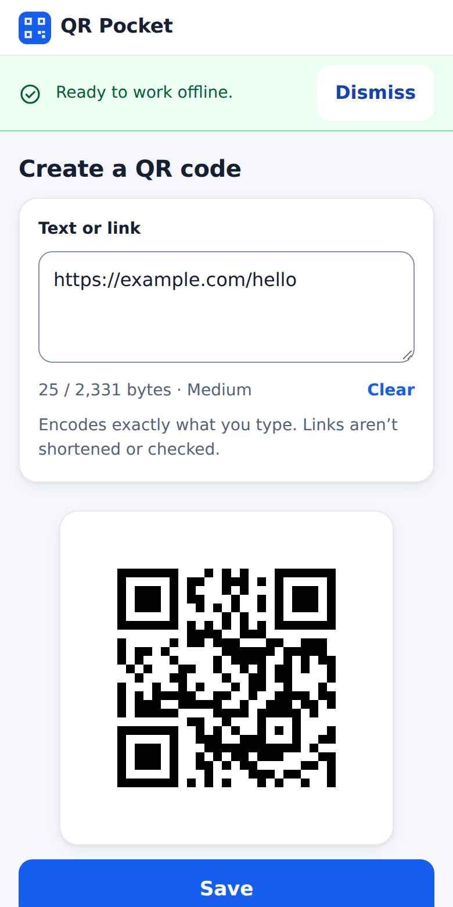
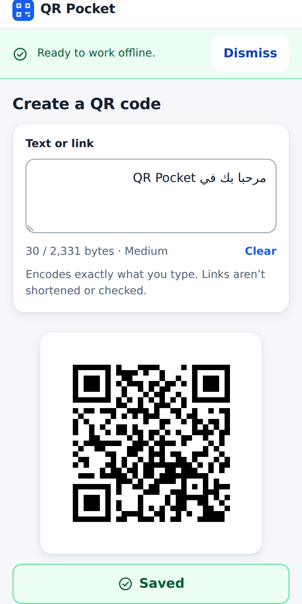
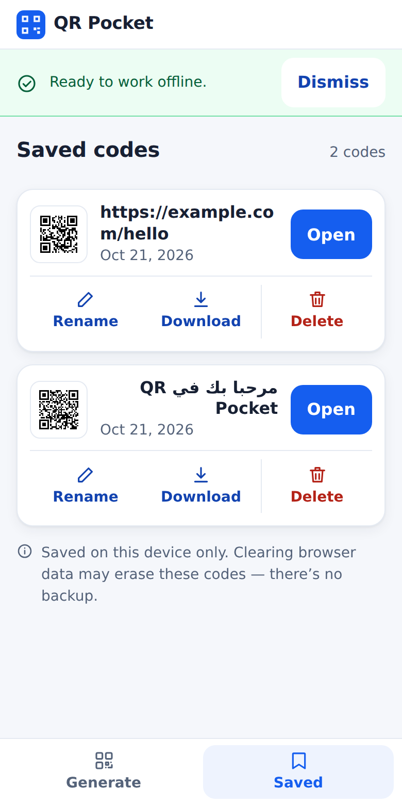
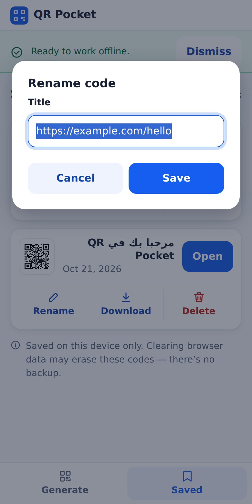
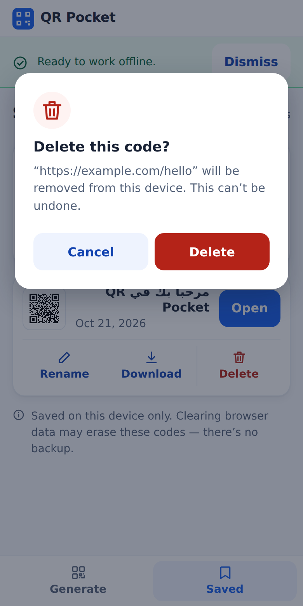
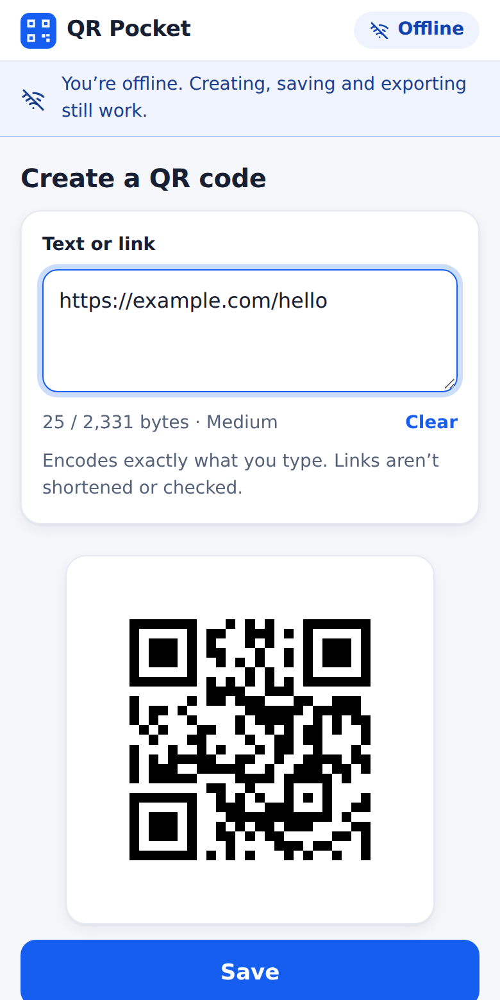

# QR Pocket — User guide

QR Pocket turns text or a web link into a QR code. You can save codes on your own device, download them as pictures and share them. It works without internet once it has been opened one time, and it needs no account.

**Status:** the app has not been published yet (GitHub Pages is switched off until the owner approves the first test deployment). When it is, the address will be **https://mabdelaziz.github.io/qr-pocket/**. The pictures below come from automated test runs of the real app on a phone-sized screen; they are not photographs of a physical phone.

---

## 1. Open it and install it

You can use QR Pocket in a normal browser tab, or install it so it opens like any other app.

### On a Windows laptop (Microsoft Edge or Google Chrome)
1. Open the address above in Edge or Chrome.
2. Look at the right end of the address bar for an **install icon** (a small monitor with a down arrow). Click it, then **Install**.
   - Edge: menu **⋯** → **Apps** → **Install this site as an app**.
   - Chrome: menu **⋮** → **Cast, save and share** → **Install page as app…** (wording varies a little by version).
3. QR Pocket opens in its own window and appears in the Start menu. You can pin it to the taskbar.

If you see no install option, you can simply keep using it in the browser tab. Everything works the same.

### On an Android phone (Chrome)
1. Open the address in **Chrome**.
2. Type something and make a QR code. Chrome may then show a card **"Keep QR Pocket on your phone"**. Tap **Install app**.
3. No card? Tap Chrome's menu **⋮** → **Install app** (or **Add to Home screen**) → **Install**.
4. Open QR Pocket from the new **blue icon with a white QR mark** on your home screen. It opens full screen, without the address bar.

Tap **Not now** if you do not want it; the card stays away for a month.

---

## 2. Make a QR code

1. On the **Generate** screen, tap the box **Text or link** and type or paste what you want.
2. The QR code appears below as you type.

**Web links.** QR Pocket puts exactly the text you typed into the code. It does not shorten the link, check that it works, or send it anywhere. Type the full link, including `https://`.

**Arabic and other languages.** Arabic, English, emoji and several lines all work. The text can run right-to-left in the box while the rest of the app stays the same.

**Too much text?** A QR code can hold a limited amount. If your text is too long, QR Pocket tells you; it never cuts text off silently. Shorten the text and try again.

**Start again.** Tap **Clear** to empty the box.

Try it: point your phone camera (or another scanner app) at the screen. Your link or text should appear.

---

## 3. Save a code, open it again, rename it, delete it

1. With a QR code showing, tap **Save**. The button changes to **Saved**. (Change the text and it becomes **Save** again, because that is a new code.)
2. Tap **Saved** in the tab bar at the bottom to see your list, newest first, each with a small picture.

- **Open** brings the text back to the Generate screen.
- **Rename** lets you give the code a clearer title.

- **Delete** asks first. Choose **Delete** to remove it for good, or **Cancel** to keep it.

**Where is it stored?** Only on this device, inside this browser (or installed app). Nothing is uploaded. QR Pocket cannot recover codes you delete, and there is no backup. See section 7.

---

## 4. Download and share the picture

- **Download PNG** saves a large, sharp picture (1024 × 1024 pixels, black on white with a white border) to your device.
- **Share** opens your device's share menu so you can send the picture to a messaging app, e-mail or cloud drive. If your browser cannot share pictures, the Share button is not shown; use Download instead.

**Where do downloads go?**
- **Android:** the **Downloads** folder. Open the **Files** app → **Downloads**, or Chrome ⋮ → **Downloads**. The picture may not appear in Photos or the Gallery straight away, or at all; that depends on your phone.
- **Windows:** your **Downloads** folder (or wherever your browser is set to save). Edge and Chrome show it in the downloads list (**Ctrl + J**).

The file name comes from the code's title and is always safe to store.

---

## 5. Using it offline

After the first time you open QR Pocket with internet, it keeps what it needs on your device. A short note **"Ready to work offline."** may appear once.

After that, with no internet or in Airplane mode you can still make, save, open, download and share codes. A small **Offline** label shows at the top, and a note says the app still works. When the connection returns, the label goes away.

You need internet only to get a **new version**.

---

## 6. Updates

When a new version has been published, the next time you open the app with internet you see a bar: **"A new version is ready."** with **Reload** and **Later**.

- **Reload** switches to the new version straight away. If you had typed text that is not saved, the bar warns you that reloading clears it.
- **Later** hides the bar. The offer comes back the next time you open the app.

The app never reloads by itself, and your **saved codes are kept** when you update.

---

## 7. Uninstalling, and what happens to your saved codes

Your saved codes live in the browser's storage on this device, not in the app files and not on any server.

- **Uninstalling the app** (Android: long-press the icon → **Uninstall**/**App info**; Windows: the app window menu **⋮** → **Uninstall**, or Settings → Apps) removes the app. Browsers often keep the site's storage, so saved codes may still be there if you open the website again, but **do not count on it**.
- **Clearing browser data / site data / cache for this site** deletes your saved codes. This cannot be undone.
- **Switching to another browser or another device** does not carry codes over. Each browser starts empty.
- **Before you uninstall or clear data,** download the PNG of any code you want to keep.

QR Pocket never uploads your codes, so there is no copy anywhere else.

---

## 8. If something is stuck (old version, blank page, odd behaviour)

Try these in order. None of them removes your saved codes except the last.

1. **Close and reopen the app.** If a bar offers a new version, tap **Reload**.
2. **Reload the page:** laptop **Ctrl + Shift + R**; phone: pull down to refresh in the browser tab.
3. **Open it in a normal browser tab** (not the installed app) and reload there. If the website works and the app does not, uninstall the app and install it again; saved codes stay if the browser keeps them.
4. **Remove the old service worker** (the part that makes offline use possible):
   - Chrome/Edge on a laptop: press **F12** → **Application** → **Service workers** → **Unregister**, then reload.
   - Android Chrome: ⋮ → **Settings** → **Site settings** → **All sites** → find *mabdelaziz.github.io* → look at the data stored, but **do not** tap **Clear** unless you have downloaded what you need (step 5).
5. **Last resort, erases saved codes:** clear this site's data (Chrome ⋮ → **Settings** → **Site settings** → **All sites** → this site → **Clear & reset**). Download any codes you need first.

If the app still shows a broken version after a fix has been published, tell the owner: there is an emergency recovery method (`docs/SW_RECOVERY.md`) that clears only QR Pocket's cached files and keeps your saved codes.

---

## 9. A quick test you can do in five minutes

1. **Generate:** type `https://example.com` — a QR code appears. Scan it with another phone: it opens that address.
2. **Save:** tap **Save** — it says **Saved**.
3. **Open:** go to **Saved**, tap **Open** on your code — the text returns.
4. **Download:** tap **Download PNG** — find the file in Downloads.
5. **Share:** tap **Share** (if shown) and cancel the menu — the app is fine.
6. **Offline:** turn on Airplane mode, close and reopen the app — it opens, shows **Offline**, and your saved code is still there.

If every step works, QR Pocket is working as it should. The full phone checklist is `docs/UAT_CHECKLIST.md`.

---

## Privacy in one paragraph

QR Pocket has no accounts, no tracking, no ads and no servers of its own. What you type never leaves your device while you create, save, download or share a code (sharing hands the picture to the app you choose, as you ask). Your saved codes stay in this browser until you delete them or clear the browser data.
